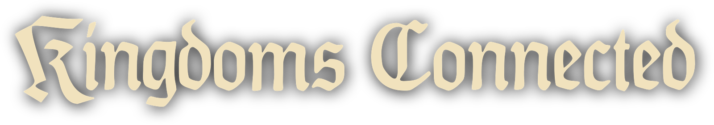

  

  
  

 

  Multiplayer for Kingdom Come: Deliverance II

  
    Brought to you by <a href="https://github.com/MafiaHub">MafiaHub</a>
    and the <a href="https://github.com/KingdomsConnected/mod/graphs/contributors">Kingdoms Connected contributors</a>.
  

  <a href="https://kingdomsconnected.com">Website</a> ·
  <a href="https://kingdomsconnected.com/download">Download</a> ·
  <a href="docs/README.md">Documentation</a> ·
  <a href="https://docs.kingdomsconnected.com">Scripting API</a>

## Introduction

Kingdoms Connected is a multiplayer mod for Kingdom Come: Deliverance II.
Built on the [MafiaHub Framework](https://github.com/MafiaHub/Framework), it
lets you play on community servers and create your own game modes.

You need a copy of Kingdom Come: Deliverance II installed to play.

## Contributing

We're always looking for new contributors. If you have ideas, suggestions
or a bug to report, join us on [Discord](https://discord.gg/WGAKZ3pwgw) or
[open an issue](https://github.com/KingdomsConnected/mod/issues).

If you're interested in development, please read our
[Contribution Guidelines](.github/CONTRIBUTING.md).

## Building

We use **CMake** to build the project. The client supports **Windows**, and
the server supports **Windows** and **Linux**.

The project builds from its own repository and downloads the required
Framework SDK automatically. Follow the [build instructions](docs/building.md)
for prerequisites, local builds and testing.

## License

The code is source available under the
[MafiaHub source-available license](LICENSE.txt).

The license keeps development focused on this repository. Forks and source
builds are for developing and testing contributions, so improvements can be
reviewed, merged and included in official releases.

Community servers must use official client and server binaries. Custom or
alternative launchers require written permission. You can configure official
releases and write your own scripts, resources and game modes through the
supported APIs.

See the license for the full terms and [NOTICE.txt](NOTICE.txt) for
third-party notices.
